# Proyecto Docker - Sistema de Gestión de Órdenes

## Integrante

- Nombre completo: Kenaliz Ayeska Chavez Servellon
- Número de cuenta: 202410010301

---


# Arquitectura

```text
Navegador
     |
     v
+------------+
| Django Web |
+------------+
     |
     v
+------------+
| Flask API  |
+------------+
     |
     v
+------------+
| SQL Server |
+------------+
```

## Contenedores

- db
- api
- web

## Red

- ordenes_net

## Volumen

- sql_data

---

# Estructura del proyecto

```text
ordenes-docker

├── compose.yaml
├── .env
├── .env.example
│
├── db
│   └── init.sql
│
├── api
│   ├── Dockerfile
│   ├── requirements.txt
│   ├── app.py
│   └── .dockerignore
│
├── web
│   ├── Dockerfile
│   ├── requirements.txt
│   ├── manage.py
│   ├── .dockerignore
│   └── proyecto
│
└── evidencias
```

---

# Pasos para ejecutar el proyecto desde cero

## 1. Clonar el repositorio

```bash
git clone ENLACE_DEL_REPOSITORIO
```

Entrar a la carpeta del proyecto:

```bash
cd ordenes-docker
```

---

## 2. Crear el archivo .env

Crear un archivo llamado:

```text
.env
```

con el siguiente contenido:

```env
SA_PASSWORD=Password123*
DB_NAME=OrdenesDB
DB_SERVER=db
DB_USER=sa
```

---

## 3. Verificar que Docker Desktop esté en ejecución

Iniciar Docker Desktop y esperar a que el servicio se encuentre funcionando correctamente.

---

## 4. Construir y levantar los contenedores

Ejecutar:

```bash
docker compose up -d --build
```

Este comando construirá y levantará los servicios:

- db (SQL Server)
- api (Flask)
- web (Django)

---

## 5. Verificar los contenedores

Ejecutar:

```bash
docker compose ps
```

Los tres servicios deben aparecer en estado activo.

---

## 6. Acceder a la aplicación

Frontend Django:

```text
http://localhost:8000
```

API Flask:

```text
http://localhost:5000/api/ordenes
```

Health Check:

```text
http://localhost:5000/health
```

---

## 7. Detener el proyecto

```bash
docker compose down
```

---

## 8. Levantar nuevamente el proyecto

```bash
docker compose up -d
```


---

# Puertos

| Servicio | Puerto |
|----------|---------|
| SQL Server | 1433 |
| Flask API | 5000 |
| Django Web | 8000 |

---

# Endpoints principales

## Órdenes

```http
GET /api/ordenes
GET /api/ordenes/{id}
POST /api/ordenes
PUT /api/ordenes/{id}
DELETE /api/ordenes/{id}
```

## Detalles

```http
GET /api/ordenes/{id}/detalles
POST /api/ordenes/{id}/detalles
PUT /api/detalles/{id}
DELETE /api/detalles/{id}
```

## Health

```http
GET /health
```

---

# Evidencias

Capturas de:

- docker compose ps
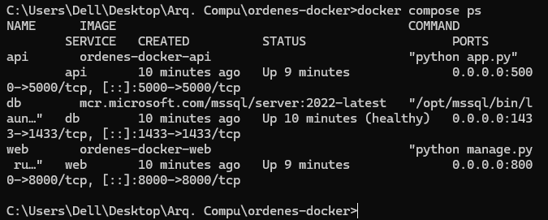

- docker stats
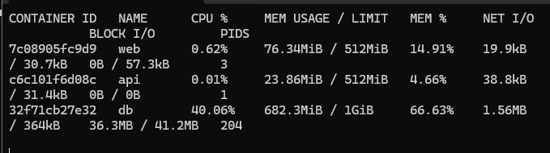

- CRUD de órdenes
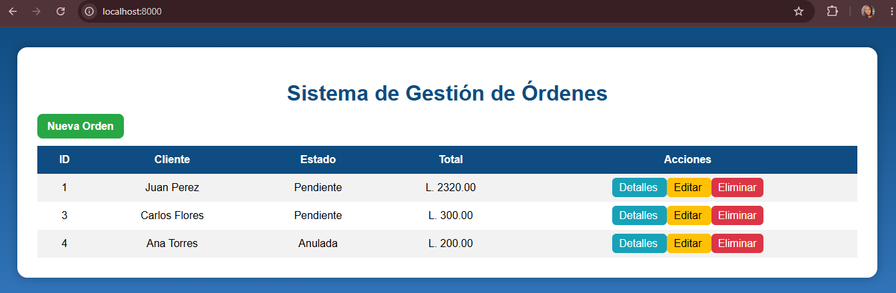
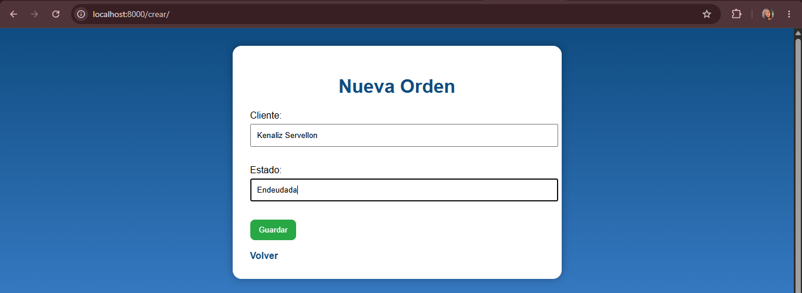
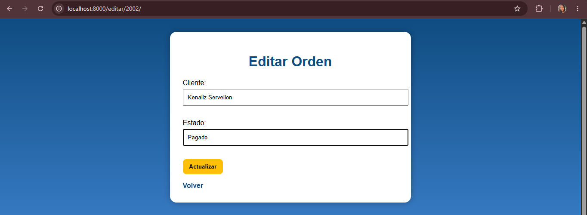
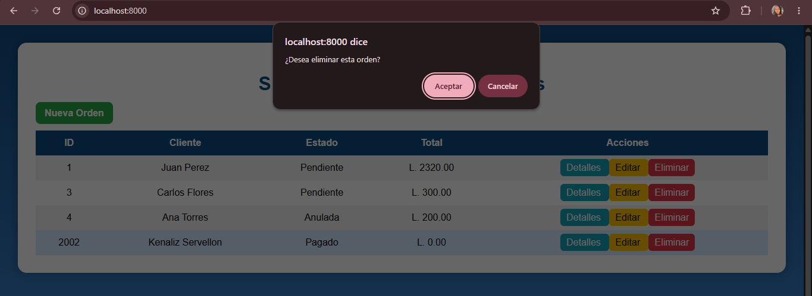

- CRUD de detalles
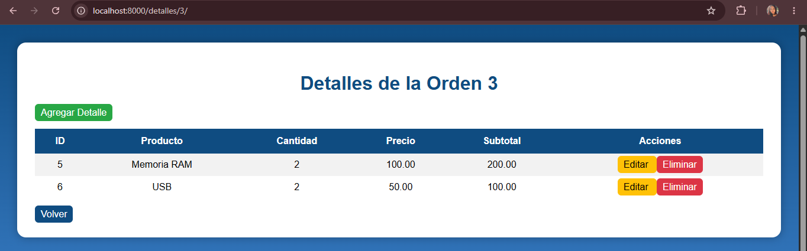
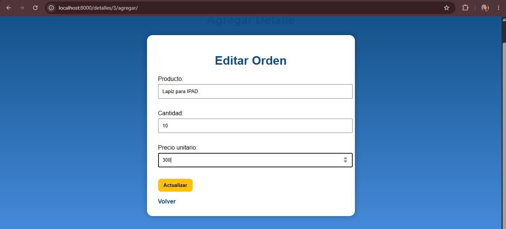
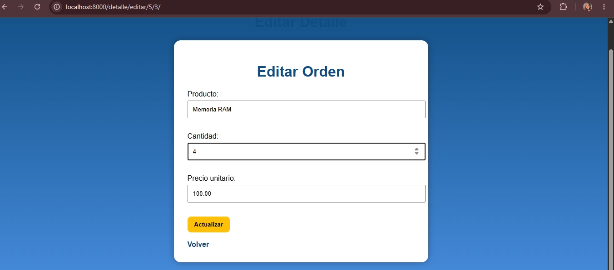
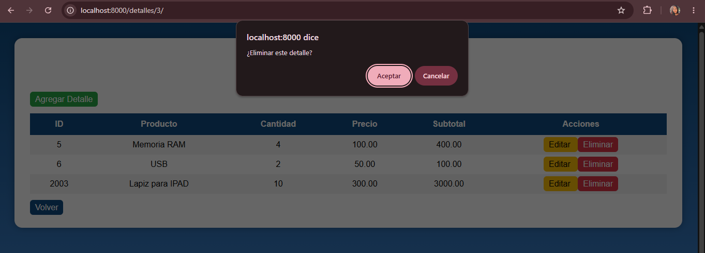

- API funcionando
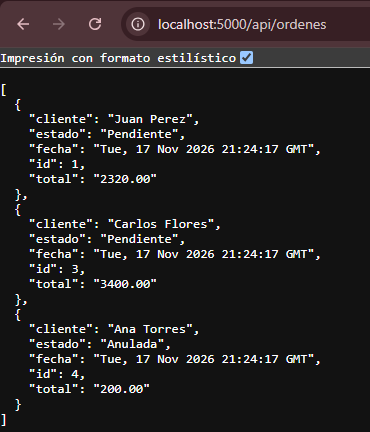

- Persistencia de datos
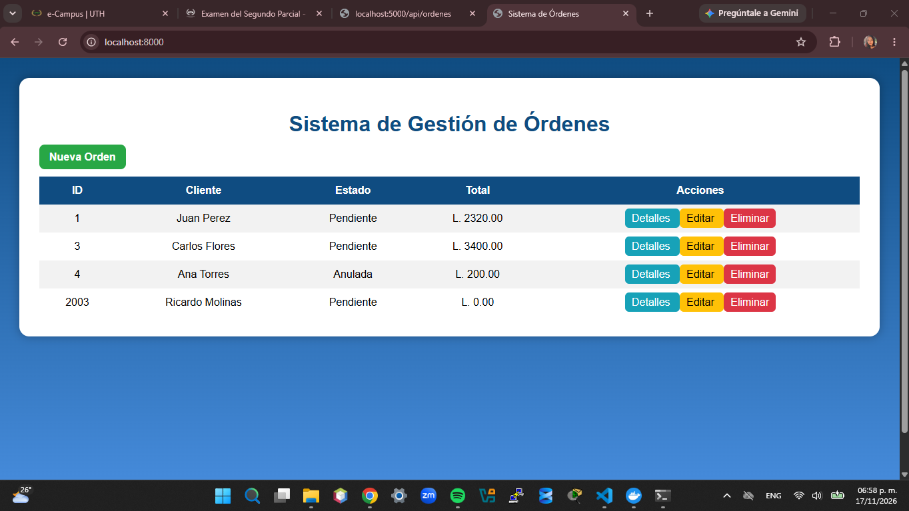
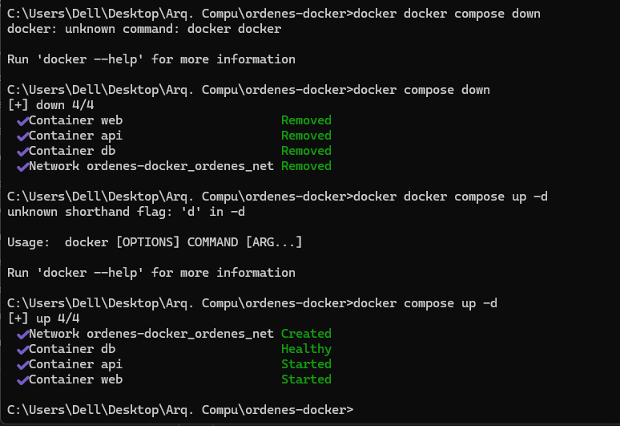
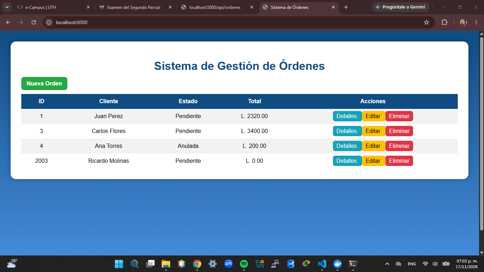